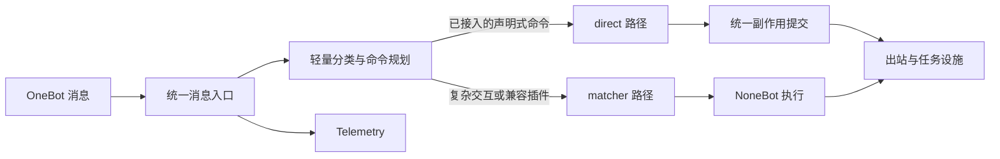

# 统一消息入口架构

本页面向维护 Pallas-Bot 内核与内置插件的开发者，说明统一运行时如何在 `direct` 与 NoneBot `matcher` 之间规划消息，并统一提交可见副作用。插件作者应依赖 [`pallas.api.runtime`](/developer/plugin-development/pallas-api-cookbook#精确命令与统一运行时)，不要直接导入本页提到的内部类型。

这套入口不是对 NoneBot 的整体替换，不要求所有插件迁移，也不改变单机统一运行时的默认部署方式。分片只负责扩展部署拓扑，与消息选择 direct 还是 matcher 是两个维度。

## 主流程

入口位于现有 OneBot / NoneBot 入站门控之后。它保留协议适配、插件加载和 NoneBot 生命周期，只将适合的消息提前交给受约束的 direct handler。`ActionCommitter` 负责 direct 的结构化结果；matcher 仍按 NoneBot 语义执行，二者随后共用发送队列等既有设施。

入站门控中的主持活动判定保留同步规则与原执行顺序，但可能访问分片 Redis 的三处决策经 `asyncio.to_thread` 执行，避免 socket 等待阻塞消息事件循环。黑名单快照轮询的远端世代 GET 与变更通知 INCR 也在工作线程执行；本地快照 patch 仍先立即生效。

黑名单快照停止或重置时取消后台任务，并等待已提交的 Redis 线程操作结束；生命周期世代校验阻止旧刷新覆盖新快照。线程中的同步操作不能强制取消，线程池排队与 Redis 超时可能延长停止等待，3 秒的后台任务等待不是整个停止过程的总时限。

入站 message_scrub 在全局本地词库之外叠加**群级追加屏蔽词**与**Bot 级追加屏蔽词**：门控只读进程内快照，命中即拦，不查 DB、不发远程请求。群快照与 Bot 快照各自独立（数字 id 相同也不串），保存后当前进程立即 patch，其他进程正常约 30 秒由周期刷新同步一次（加载失败保留旧快照，故障期间不保证硬期限）；加载期间发生的本地 patch 以版本号挡住旧快照回写，清空也增版本以免旧 load 复活。全局总开关 `PALLAS_MESSAGE_SCRUB_ENABLED` 关闭时，群词与 Bot 词一并失效。群内 `添加屏蔽词` / `删除屏蔽词` / `查看屏蔽词` 命令（`packages/blacklist`，默认群管/群主）读写 `group_config.message_scrub_extra`；私聊同命令字读写 `bot_config.message_scrub_extra`，作用于该 Bot 所有群与私聊，仅**当前 Bot 号主**可管理（除可配置命令权限外另有号主硬条件，其它 Bot 号主、未绑定的超管、群管、ACL 与 everyone 覆盖都不能越过；群临时会话不能管理）。两条命令路径写后同样 patch 本进程对应快照，并受每群 / 每 Bot 锁序列化以避免并发丢词（仅同进程；多 worker / 多部署与 WebUI 整数组保存为后写覆盖）。严格合法且已授权的命令在入站即被标记，只放行准确目标 matcher（群与私聊同命令字互不串号），并在 run_preprocessor 围栏跳过其余 matcher，避免落入 LLM / 复读 / direct runtime。

## 规划与执行

direct 路径按以下顺序工作：

1. 入站层从事件构造 `MessageContext`，记录账号、群、消息文本、路由候选等本次处理所需信息。
2. 生命周期从 `pallas.api.runtime` 的精确文本或前缀命令声明构造 registry snapshot。运行中的一次规划只读取该快照，不让插件注册变化破坏当前决策。
3. `MessagePlanner` 根据消息分类、路由候选与 handler 声明生成 `HandlingPlan`。只有唯一且满足约束的 direct handler 才会进入 direct 执行；其他情况明确交回 matcher。
4. `MessageRuntime` 执行 handler，并将公共 `DirectCommandResult` 转换为内部 `HandlingOutcome`。
5. `ActionCommitter` 统一提交回复、持久任务、跨 worker 动作和完成效果；提交结果随后写入 telemetry。

planner、registry、`HandlingPlan`、`HandlingOutcome` 和 `ActionCommitter` 都是内部 ABI。插件只声明“哪些命令文本或前缀由谁处理”以及“处理结果包含哪些受支持效果”。前缀声明仍由框架执行 `startswith` 匹配，不接受插件自定义 planner predicate。

## 副作用与失败边界

| 结果 | 内部提交行为 | matcher 行为 |
| --- | --- | --- |
| 回复 | 通过 Bot 发送接口统一发送 | 默认不继续 |
| `DirectWorkJob` | 写入 durable work store，使用幂等键 | 默认不继续 |
| completion effect | 在提交阶段执行并等待完成 | 默认不继续 |
| `matcher_fallback(reason)` | 不允许携带任何副作用 | 回到 matcher |
| `continue_matcher=True` | direct 结果正常提交 | 提交后继续 matcher |

关键不变量是：**只有尚未开始 direct 副作用时才能 fallback。** handler 在产生结果前失败，且该 handler 允许错误回落时，可以交回 matcher；显式 `matcher_fallback()` 也必须是无副作用结果。

一旦 `ActionCommitter` 开始提交，下游可能已经接受任务或发送动作。此时提交失败会记录为 `SideEffectCommitError`，但运行时仍把本次消息视为已经由 direct 取得所有权，不再用 matcher 重试。这避免“发送成功但确认失败”一类情况造成重复回复或重复执行。

durable work handler 可以返回 `DirectWorkResult`，其中的 `DirectBotAction` 由 work auxiliary 按顺序交给现有 `bot_action` 设施，单机直接投递，分片时路由到持有目标 Bot 连接的 worker。handler 在返回结果前失败仍使用 work job 的重试策略；结果提交一旦开始便可能已经产生可见动作，此后失败会直接 dead-letter，不再重跑整个 job。

## 实验性 MaiBot 桥（默认关闭）

`pallas/product/agent_bridge/` 提供原创 Legacy WebSocket 文本桥，单机 unified 部署可将一个或多个 Bot 的显式允许群交给同一个 MaiBot 进程处理聊天。账号共享核心人设和模型配置，不为每只牛牛启动独立进程。默认不开连接、不接管任何群；启用但配置无效或处于分片部署时明确报错。桥本身不负责安装、启动 MaiBot，也不代替用户接受其协议；可选托管与配置同步见下文。

入口仍先执行既有预处理、权限与命令分类。旧 LLM 聊天 direct 入口已撤销，非 LLM 的 Repeater direct、语料选择和 fanout 仍保留。移交范围内的非命令消息在 stale / 过载处理后执行仅采集路径，再尝试转发；随后仍运行其他 matcher，仅排除重复采集的 Repeater matcher，不再通过懒加载恢复旧 LLM 聊天注册。命令保持原处理路径；范围外仍可按原开关采集和复读接话，但不会进入旧 LLM。降质时保留消息采集、停止图片侧工，学习队列沿用先持久化消息、再按压力跳过学习的规则，不向 MaiBot 外发；过期消息沿用入口丢弃规则。

桥转发归属固定为启动时的 `(bot_id, group_id)` 快照，直到停止桥才释放，不随连接状态变化。断线、实时配置无效、关闭开关或移除群均不会恢复旧 LLM，重启也不是切回旧 LLM 的开关。实时关闭、移除账号或移群会拒绝入站转发和回投；新增账号或群、修改连接参数需要重启。纯语料主动发言、复读、自动表情/跟图和 fanout 保留；已移交范围继续沿用桥归属抑制以避免重复回复，主动发言在候选账号选择前排除移交账号。酒后 LLM/RWKV 聊天入口退役；消息采集、数据维护和确定性游戏不受影响。

转发独立检查异步消息审核、聊天插件群开关、睡眠、群封禁和 `llm_chat.chat` 权限，不以采集成功作为安全门。回投检查实时准入、群开关、睡眠、群封禁与异步审核，按回包的明确账号获取 Bot，经 `send_group_message_with_receipt` 和既有发送队列发送，抑制旧自动跟图。单账号模式只有获得真实消息 ID 才回传 echo；多账号模式保留本地真实回执校验，但不向上游回填 ID，原因见下一段。回包没有原始用户事件，不声称重新执行了用户级 ACL。复核发生在入队前，不保证撤销已入队的发送。

同平台的所有账号复用一条 WS：Legacy 服务端按 `platform` 只保存一个连接，重复连接会踢掉旧连接。入站同时提供正式顶层 `account_id` 与兼容附加元数据，多账号消息 ID 按账号和群添加命名空间；受管账号彼此发出的消息不回送，避免循环。出站根据明确 account 声明或 Bot 发送方 `user_info.user_id` 路由，多个身份声明必须一致；多账号缺失身份或身份冲突时拒绝，不按群或首账号猜测。去重包含账号与群，不因两个账号收到相同 QQ 消息 ID 而互相吞掉。

当前上游临时出站 ID 仅含毫秒时间戳，Legacy echo 又按裸 ID 跨会话更新；多账号模式因此从第一条回包起完全禁用 echo，不随在线账号数量改变。纯文本发送仍可用，但引用、撤回、编辑和依赖真实 ID 的回复映射不支持。这只避免该回填风险，不代表修复了上游内部 ID 的全部歧义，也不代表不同账号的所有学习数据已完全隔离。

会话 ID 包含账号，但记忆检索还受 MaiBot 的 `[a_memorix]` 配置控制：默认 `global_memory_sharing_enabled = false`，未配置共享组时按当前会话收敛；开启全局共享或跨会话共享组会改变这一边界。同步保留这些非受管配置，不把“账号会话 ID 不同”说成无条件的记忆隔离。

配置只从现有合并配置读取，手动写入 `config/pallas.toml` 的 `[env]`；WebUI 落盘的同名键仍具有更高优先级。未新增管理页面。

| 配置键 | 含义 |
| --- | --- |
| `MAIBOT_BRIDGE_ENABLED` | 默认 `false`，显式开启才连接 |
| `MAIBOT_BRIDGE_URL` | Legacy WebSocket 完整地址，通常以 `/ws` 结尾 |
| `MAIBOT_BRIDGE_BOT_ID` | 旧版单账号配置；与 `MAIBOT_BRIDGE_BOT_IDS` 互斥 |
| `MAIBOT_BRIDGE_BOT_IDS` | 多账号非空 JSON 列表，例如字符串 `'[100001,100002]'`；不会自动接管未登记账号 |
| `MAIBOT_BRIDGE_GROUP_IDS` | 所有登记账号共用的非空群白名单，例如字符串 `'[700001,700002]'`；各账号仍受原群开关与权限限制 |
| `MAIBOT_BRIDGE_PLATFORM` | 与服务端路由一致的平台标识 |
| `MAIBOT_BRIDGE_TOKEN` | 可选鉴权值，不写入日志或公开配置 |

生命周期在发送队列就绪后连接桥，在关闭发送队列前停止桥。连接握手最多等待 10 秒；连接失败时命令服务仍可继续，但移交群保持仅采集、不回退。当前仅支持纯文本，去重窗口只在进程内有效；无自动重连、离线补发、跨重启去重、媒体桥、旧记忆迁移或语义风格 Hook。共享核心人设可通过下述显式同步迁移；DB 中的账号行为权重、学习别名和群风格未做完整迁移。协议服务端回环与模拟 dispatch / 发送队列测试不能代替真实 MaiBot 和 QQ 联调。

### 同域 MaiBot 控制台代理

`/pallas/maibot/` 在 Pallas WebUI 的 SPA catch-all 之前注册，HTTP、静态资源与 WS 均先验证真实控制台会话 Cookie，再交由 MaiBot 原生登录鉴权。API Key、查询参数或原生 WS token 不能代替 Pallas 会话；写请求检查同源 Origin/Referer，WS 强制同源并周期重验会话与受管进程身份。

代理仅访问受管实例配置的字面量 loopback 地址，不接管外部实例。浏览器原生 Cookie 为 `pallas_maibot_session`、Path 为 `/pallas/maibot/`，上游映射为 `maibot_session`；设置、删除与安全属性一并处理，Pallas Cookie、API Key 和内部 token 不外传。仅改写该前缀内的原生重定向，拒绝外部跳转；资源缺失不伪装为 SPA HTML。HTTP 请求体上限为 101 MiB，WS 单消息上限为 4 MiB，断连关闭上游流。

代理提供传输与会话隔离，不证明模型可调用，也不限制原生模型或插件管理；本机管理员、可信插件代码及目标监听端口的 OS 归属不由该代理沙箱化。缺少可核实的受管进程或合法目标时返回 503。

### 自研 agent 入口退役

Pallas 的旧聊天提交与 kernel 调度不再接受生成请求，遗留 RWKV 聊天不再访问 AI Runtime 聊天端点。旧任务类型 `llm_chat`、`ollama`、`chat` 不再登记到本地或 Redis；历史记录仍可被 callback 原子领取，随后终止，不获取 Bot、不写入对话结果、不发送文本/语音/失败提示。媒体任务 `draw`、`sing`、`play`、`request`、`tts` 保持原回调能力。

旧聊天工具 HTTP 入口不再默认注册，不能将其直接复用为 MaiBot 工具网关；共享工具注册表和显式命令执行仍保留。非 LLM Repeater fanout RPC 与通用跨 worker 发送、命令动作保持可用，并沿用原权限和桥归属检查。`LLM_CHAT_ENABLED` 等共享出口配置继续控制 Pallas 的 Embedding、标注等能力，不作为旧 LLM agent 的复活开关，也不代替独立 MaiBot 的运行管理。

### 可选统一启动（Linux）

`pallas/console/cli/maibot_aux.py` 将一个已准备好的 MaiBot 源码实例接入现有 unified 启停流程，不另建 supervisor。维护者须先自行安装该实例的依赖、配置模型，并在前台阅读和确认当前 EULA 与隐私条款；托管只读校验确认文件与协议内容一致，不写确认文件、不代填同意或升级确认，不支持安装版 wheel。协议变更或旧版本升级需要交互时，应先在 MaiBot 实例中前台处理。

除上一节桥配置外，手工设置以下 `[env]` 键：

| 配置键 | 含义 |
| --- | --- |
| `MAIBOT_MANAGED_ENABLED` | 默认 `false`；开启托管必须同时开启有效桥 |
| `MAIBOT_MANAGED_DIR` | 已准备好的 MaiBot 源码实例目录；相对路径以 Pallas 仓库根为基准 |
| `MAIBOT_MANAGED_PYTHON` | 可选独立解释器路径，默认实例的 `.venv/bin/python`，不复用 Pallas 环境 |

托管要求桥地址为本机明文 `ws://127.0.0.1:端口/ws`（也支持 `localhost`、`::1`），与实例 `[maim_message]` 的监听端口及地址族相符；远程地址、其他路径、URL 内凭证或查询参数均拒绝。启动先检查源码入口、可执行解释器、两份 TOML 配置、协议确认和端口，再等待消息端口可连接，最后才启动 Pallas。就绪等待最多 60 秒，只代表 transport 可连接，不代表模型或插件健康；端口被未知进程占用时拒绝启动，不接管外部实例。

继续使用 `uv run pallas run -d`、`uv run pallas stop`、`uv run pallas restart -d`、`uv run pallas status` 和 `uv run pallas logs`。Pallas 已运行时才新启用托管，必须 restart；桥没有自动重连。停止先结束 Pallas/桥，再停止已核实身份的 MaiBot 进程组，给予约 55 秒优雅退出。启动失败只回滚本次新建进程，不误停已有实例；停止失败会阻止 restart。

运行文件位于 `data/pallas_maibot/run/`，日志为 `data/pallas_maibot/logs/maibot.log`。进程身份依赖 Linux `/proc` 核实，不支持的平台拒绝启用；无法核实的活 PID 不接管、不发送终止信号。这里只保证串行重复启动的幂等，不承诺并发 CLI 启动、跨平台托管、无主孤儿组自动清理或逃逸到新 session 的孙进程回收。无法安全停止的残留需人工确认处理。

### 共享人设与模型配置同步

设置 `[env]` 的 `MAIBOT_CONFIG_SYNC_ENABLED = "true"`，表示明确授权 Pallas 在受管实例停机时接管下述字段；默认 `false`，未开启时保留现有手工 MaiBot 配置。只同步已准备好的实例，不替用户安装或接受协议，外部非托管实例不自动写入。开启后需用 restart 应用，不能靠重复 start 宣称已更新运行中实例。配置同步与托管启停共用锁，未知存活实例、占用端口和未解决孤组均拒绝同步；转换失败不启动实例。

- 人设读取当前共享基础提示词，包括有效的 append/replace 覆盖，写入 `personality.personality`；通称写入 `bot.nickname`、`bot.alias_names`。不调用 DB 人格编译，不把酒后状态、旧 agent 工具治理或行为指纹混入目标，也不安装风格指导 Hook。
- `replyer`、`planner` 读取 Pallas 的 `llm_chat` 有效端点，`utils` 读取 `turn_decision`，Embedding 只使用真实远程 Embedding 线路；其余模型角色保留目标原生或手工配置。任务输出上限、温度等执行参数保留 MaiBot 原生/手工值，不把旧 agent 的短回复预算套给规划或摘要任务。Chat Completions/Responses 分别使用上游对应客户端，保留已明确的 effort 参数及 CPA 流式要求；请求配置为关闭思考不代表服务端确实关闭。
- 首轮不支持无法等价执行的多候选回退、多密钥轮换、原生 Anthropic/Ollama 请求协议，以及适用的 provider 日费用/token 封顶和 Pallas 聊天日调用/token 封顶。这些情况在写盘前明确拒绝，不选择首模型或静默放宽预算。
- 同步仅接受已核对的目标版本：`bot_config.toml` 的 `[inner].version` 为 `8.15.47`，`model_config.toml` 为 `1.17.24`；版本变化需更新适配，不伪造上游版本。

只更新受管字段和 `pallas-` 前缀的模型记录，保留其他配置与注释。首次接管备份为同目录的 `*.toml.pallas-backup`，不会覆盖内容不同的既有备份；配置目录、目标和备份不接受符号链接。密钥只写入实例模型文件，目标、临时文件与备份使用 `0600`，不进入日志。`.pallas-managed.json` 仅记录受管字段摘要，检测到手工修改受管内容时拒绝覆盖。

重复同步相同输入不改写文件；dry-run 不落盘。两文件先完成渲染和关键结构校验再替换，普通失败回滚原文件；进程在跨文件替换中被强制 KILL 的事务恢复不在首轮保证内。校验覆盖已冻结的版本、类型、引用和任务范围约束，不等于在本机执行了完整上游配置加载器。

## 出站发送队列

发送队列的 `depth` / `depth_live` 统计所有已接纳任务，包括排队、执行与退避中的重试，`max_depth` 限制接纳总量。高优先级发送在满载时等待至 `PALLAS_SEND_QUEUE_ENQUEUE_TIMEOUT_SEC`，超时明确失败；低优先级丢弃策略不变。停止时先拒绝新任务，结束容量等待者与已接纳调用，并取消延迟重试；重启会建立新生命周期，旧重试不会进入新队列。回执超时仍按“结果不明确”处理，不盲目再次发送。

同一账号的最小发送间隔由每账号的异步锁串行保护：等待与时间戳更新在锁内完成，真正的 adapter 调用不持锁，因此不同账号之间仍可并行。`send_queue_status()` 的 `workers` 是配置目标值，`workers_running` 是当前实际运行的 worker 任务数；worker 任务只在启动时创建，调整数量需要重启。启动时关闭的发送队列不会安装发送补丁，运行期重新开启同样需要重启。发送队列配置统一读配置快照，边界为 `max_depth` 32～4096、最小间隔取整数毫秒（0～2000）、worker 1～16、入队超时 0～30 秒；前三项按边界截断，入队超时超过 30 秒会校验失败。完整停止后账号节流锁属于旧事件循环，会随停止流程一起释放，跨事件循环重启不会复用旧锁。

## 档位与配置热载

命令、闲聊、数据库、外呼各档位的 controller、占用计数与等待者属于运行期资源。WebUI 保存配置或插件元数据刷新只清空路由映射与前缀缓存，并在原 controller 上应用新的上限：已持有档位的执行不会被打断，下调上限后新请求按新上限阻塞，释放后占用归零。重新安装或替换 controller 会让旧任务的 release 落到新对象上，因此不允许在刷新时重建。

上限随配置快照热载：准入入口发现新快照（例如分片 worker 从磁盘 revision 看到配置变化）时原地同步上限，不需要广播或重启；同步只比较配置值，不覆盖聊天档的自适应扩容。

`PALLAS_DISPATCH_LANES_ENABLED` 是启动开关：进程首次初始化档位时读取一次，之后 wrapper 与准入使用同一运行态，不会因保存期间读到不同值而出现“未计数却释放”。关闭期间新请求直接放行、已持有档位照常释放；启动时关闭后需重启才能开启。storage 档位在 PostgreSQL 压力下动态减半，属实时判断；PG 连接池容量与按舰队规模计算的默认上限在配置快照生成时确定，改动这些启动期参数需要重启。

## fallback 与 continuation

fallback 表示 direct **没有处理**本次消息，由 matcher 接管；continuation 表示 direct **已经处理**，但业务明确要求 matcher 继续运行。两者互斥。

常见 fallback 原因包括权限不满足、玩法当前未激活或 handler 约束不成立。continuation 只用于同一消息确实需要 direct 与 matcher 协作的少数场景，不应作为迁移期间的默认保险开关。

## 运行指标

入口持续维护不含消息正文的聚合 ingress 指标，包括消息量、`matchers_selected`、耗时与 direct/matcher 完成结果。它们用于发现过载和选择后续迁移候选；不再写入逐消息的试验 JSONL 或保留灰度差异记录。

## 插件归属与渐进接入

每个命令声明包含稳定的 `handler_id`、插件 `module`、精确文本或前缀集合和 `command_id`。`module` 用于生命周期清理和候选归属，`command_id` 复用现有权限配置。同模块内相交的精确文本/前缀声明会在构造快照时跳过；多个 direct handler 仍声称同一条消息时，planner 不猜测胜者，而是保守交回 matcher。

迁移单位是**命令**，不是插件：一个插件可以让高频、精确、单次处理的命令走 direct，同时保留救人、补枪、状态 matcher 或多步会话等复杂路径。社区插件可以永久只使用 matcher；只有确实需要缩短高频命令路径时才接入公共 API。

## 代码位置

| 职责 | 位置 |
| --- | --- |
| 插件公共声明与结果类型 | `pallas/api/runtime/__init__.py` |
| planner、registry、模型与提交器 | `pallas/core/platform/message_runtime/` |
| durable work result 提交 | `pallas/core/platform/work_jobs/` |
| NoneBot 入站衔接与路径指标 | `pallas/core/platform/ingress/` |
| direct / matcher 历史指标展示 | `packages/pb_webui/` |
| 公共 API 契约测试 | `tests/api/runtime/` |
| 内核运行时测试 | `tests/platform/message_runtime/` |

对外接入示例见 [`pallas.api` Cookbook](/developer/plugin-development/pallas-api-cookbook#精确命令与统一运行时)；用户能感知的消息流程见[核心概念](/guide/concepts#通信路径)。
