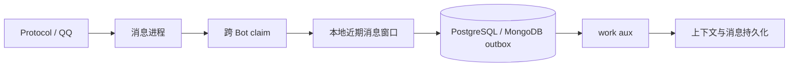

# Work Aux

`work aux` 是与消息进程并列的后台消费者。它把可重试、会写数据库或产生派生数据的工作移出 ingress；普通单进程部署不需要 Redis，任务默认保存在当前 PostgreSQL 或 MongoDB 的 outbox。

## 消息路径



主进程只保留下一次接话所需的近期窗口，并冻结当前消息及其前序快照后提交 outbox。`work aux` 领取带租约的任务，执行上下文学习、消息持久化及其他派生工作；异常会按任务状态重试。这样辅进程延迟或短暂重启不会阻塞命令、回复和多 Bot claim。

当前首个任务类型是 `repeater.learn`。它不会修改消息进程的内存窗口，因此新消息在 aux 尚未完成时仍可参与后续接话。

PostgreSQL work-job 的单条入队、批量入队与终态重入队共用 JSONB payload 规范化：递归移除实际 NUL，不修改调用方对象；仅接受 JSON 值与字符串键，键清理后碰撞则拒绝，避免静默丢字段。图片采集与复读 outbox 隔离永久无效任务；瞬时写入失败按有上限的退避重试，错误日志只记录批次数量与异常类型。消费者关停时会结清已取出批次的队列记账。

领取（`claim_many`）共用一条总预算（默认 4s，可用 `PALLAS_WORK_CLAIM_STATEMENT_TIMEOUT_MS` 调整）：查询前按剩余预算重设 `SET LOCAL statement_timeout`，异步总 deadline 同时覆盖查询、ORM flush 与 commit；预算耗尽后不再发后续查询或提交，慢查询按失败退避重试。

## 运行与扩展

`uv run pallas`、`uv run pallas run unified` 会同时维护消息实例与一个 `work aux`；`uv run pallas status` 显示它的 pid 和日志。完整分片启动也只维护一个 aux，避免每个 worker 重复拉起消费者。

当并发槽至少为 2、且首个 `priority_tiers` 分桶中存在可运行的非短链路 handler 时，work aux 会为交互任务保留一个独立消费者。该 lane 只通过 `kinds` 领取首个 priority tier 中的 kind（生产入口为 `sing.submit`、`sing.request_song`、`tts.submit`），使用单任务批次；普通后台任务通过 `exclude_kinds` 排除这些 kind，不能占用该 lane。默认并发 4 时容量拆为交互 1、短链路 2、通用 1；并发 3 时各 1。若并发只有 2 且三类 handler 都存在，无法同时隔离三条 lane，则保留 1 个交互槽，剩余槽在短链路与其他任务间共享，并让短链路通过 priority tier 优先。

其余容量继续静态分池：向上取整的一半留给 `repeater.message`、`repeater.learn`、`image_cache.capture`，其余槽处理其他任务。短链路池通过 `kinds` 限定，通用池用 `exclude_kinds` 排除短链路与交互 kind，同时仍可消费外部 handler 与未知 kind；`bot_action.send` 等显式排除对所有池生效。不会动态借出保留槽，也不会增加总容量。

短链路池按 `created_at` FIFO，不使用严格优先级，避免持续消息/学习积压令图片采集永远排在后面。若首个 priority tier 没有可运行的非短链路 handler，或不存在两类以上任务，则退回原有的两池/单池逻辑；单槽或缺少任一类 handler 时不分池，存在短链路 handler 时回退 FIFO，避免严格优先级长期饿死某类任务，也不为不存在的 handler 空留槽。独立通道只能避免普通任务阻塞交互任务，不能抢占已经卡死的 handler；发现租约长期续期时仍需清理卡死任务并重启 work aux，参考 `docs/agents/playbooks/sing-work-aux-stuck.md`。`image_cache.capture` 还需下载外部图片，因此分池不保证任务必在图片 TTL 内完成，现有 TTL 和超时保持不变。

消费者池和状态发布器由 `asyncio.TaskGroup` 托管；服务取消或任一子任务异常时，会取消并等待所有同级任务清理后再退出。

多机或更高吞吐时可手动启动更多 `bot_work_aux.py` 消费者。数据库领取使用租约，多个消费者不会领取同一条正在持有租约的任务。先观察 outbox 积压与数据库写入能力，再增加消费者；不要把 worker 数与 QQ 账号数绑定。

## Redis

Redis 不参与默认 work aux 的可靠性：PostgreSQL / MongoDB outbox 是任务事实源。Redis 用于分片协调、本机 Embedding，以及 Pallas-Bot-AI 的 Celery broker、结果和 GPU 锁；这些用途可共用一个 Redis，以键前缀或逻辑 DB 隔离。

本机希望由项目创建 Redis 时执行：

```bash
uv run pallas redis start
```

该命令会先复用可达的 `REDIS_URL`；未配置时用 Docker 创建带持久卷的 `redis:7-alpine`，仅绑定 `127.0.0.1` 的随机端口，再写入 `data/pallas_config/webui.json`。没有 Docker 时不会阻止单机 Bot 或 work aux 启动。
